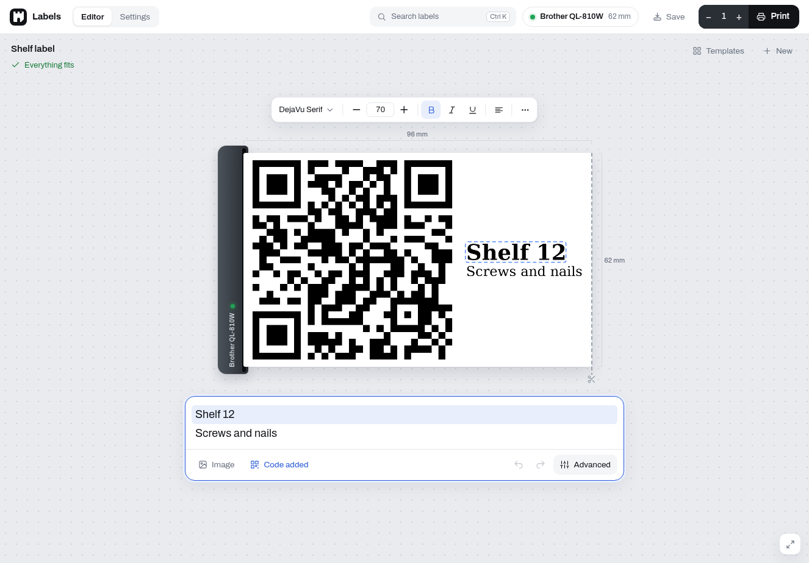
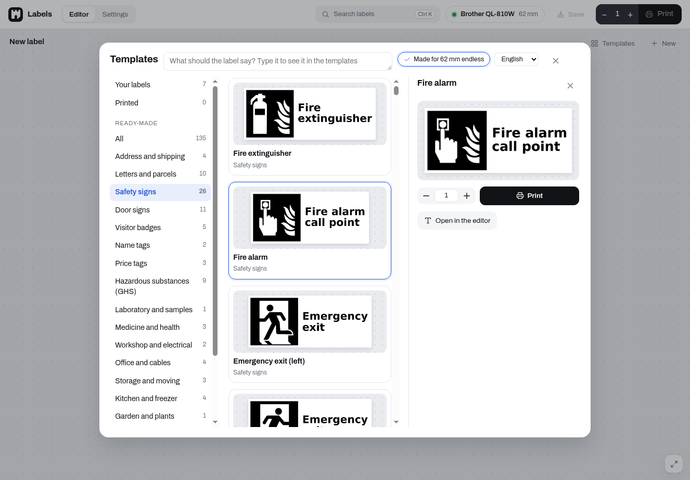
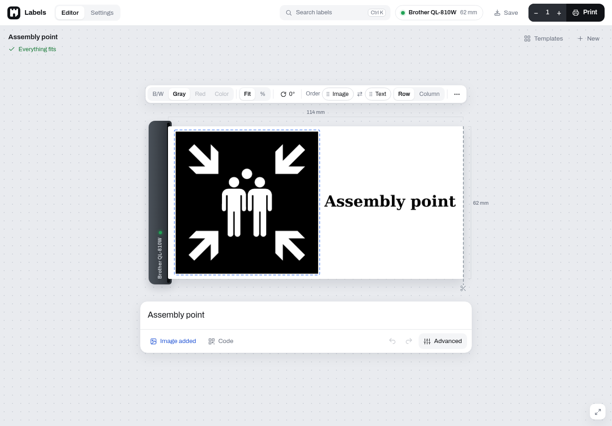
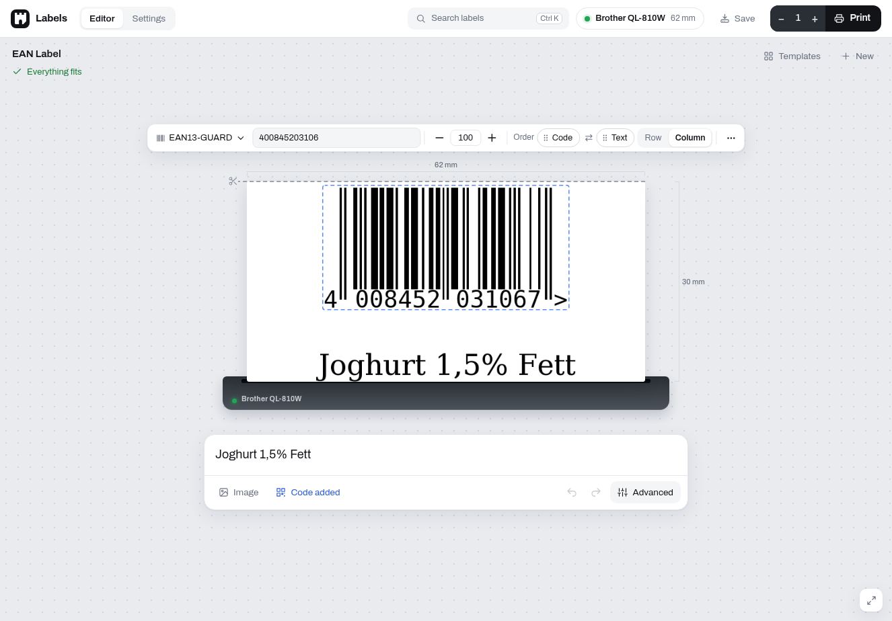
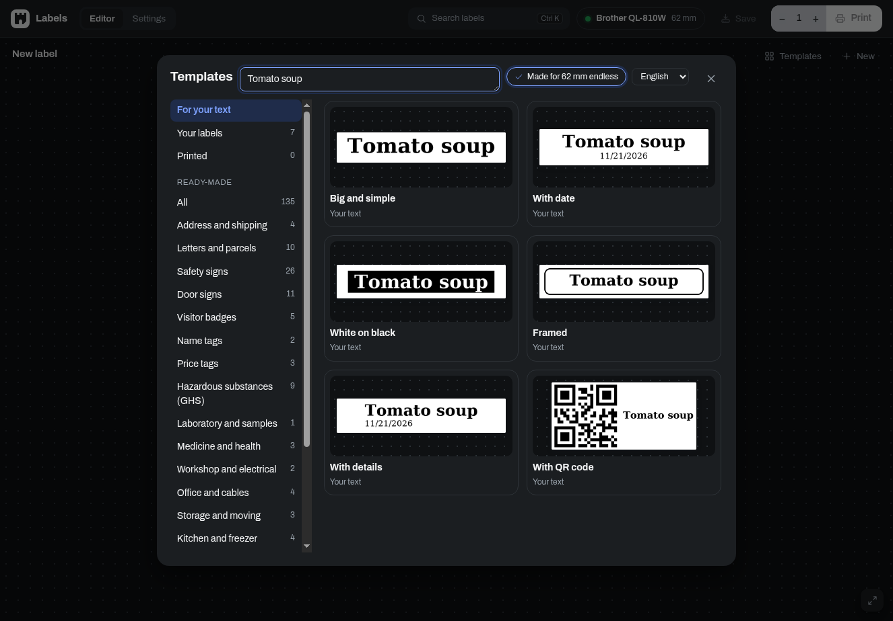
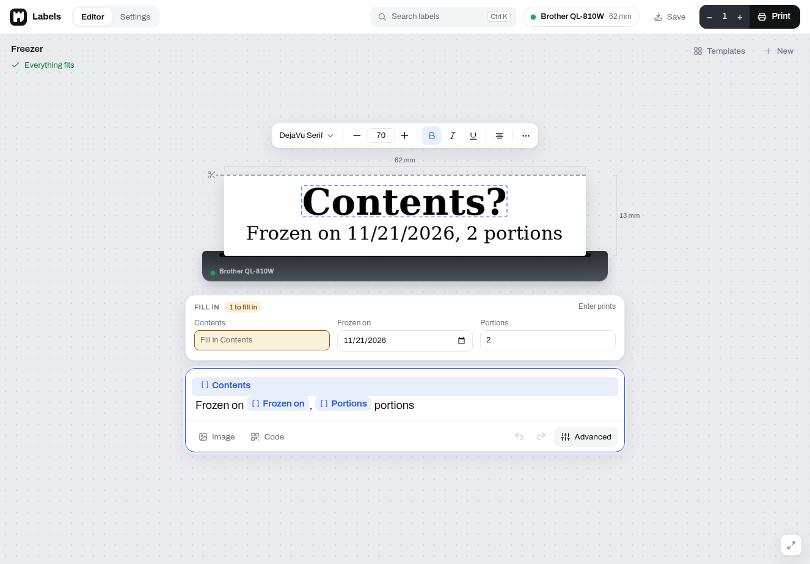
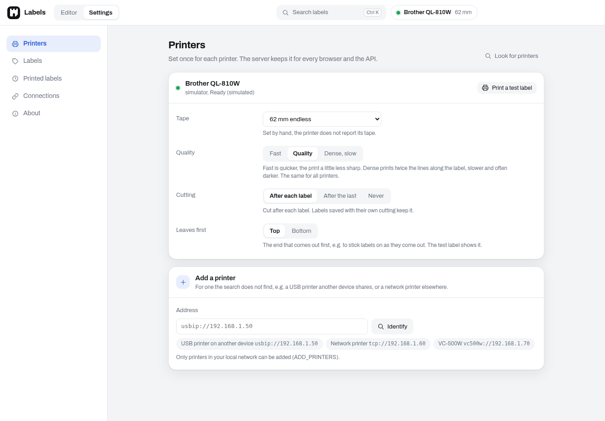

# Labelburg

[](https://github.com/DL6ER/labelburg/actions/workflows/ci.yml) [](https://github.com/DL6ER/labelburg/actions/workflows/codeql.yml) [](https://github.com/DL6ER/labelburg/actions/workflows/devcontainer-ghcr.yml)

Design and print labels 100% offline. With Labelburg you design labels in your web browser, on a computer or a phone, and print them on your label printer. You set it up once on a computer that is always on, e.g., a Raspberry Pi or a home server, and everyone at home or in the office can use it from their browser. It needs no cloud and no app of the printer's maker, and your saved labels stay on that computer, also through updates. Labelburg is 100% free, with no account, no subscription and no paid version, forever. It is fully open source under the GPLv3: all of the code is on GitHub and stays fully open.



## Supported printers

| Vendor | Printers | Labels |
|---|---|---|
| Brother | PT-E550W, PT-P700, PT-P750W | TZe tapes 6 to 24 mm wide: laminated, non-laminated and fabric (iron-on) tapes, and heat-shrink tubes in compatible cassettes |
| Brother | PT-P900W, PT-P950NW | TZe tapes 18 and 36 mm wide |
| Brother | QL-500, QL-550, QL-560, QL-570, QL-580N, QL-600, QL-650TD, QL-700, QL-710W, QL-720NW | up to 62 mm wide |
| Brother | QL-800, QL-810W, QL-820NWB | up to 62 mm wide, also black/red |
| Brother | QL-1050, QL-1060N, QL-1100, QL-1110NWB, QL-1115NWB | up to 103 mm wide, e.g. 4 x 6 in shipping labels |
| Brother | VC-500W | 9 to 50 mm wide ZINK tape in full color, about 40 s per label |
| Epson | TM-T20II (USB) | 80 and 58 mm receipt paper, cut |
| Niimbot | D110_M (Bluetooth) | 12 to 15 mm wide die-cut thermal labels, torn off, printed on 12 x 40 mm only |
| PUQU | Q00 (Bluetooth), also sold as the [Reekon P1 Tagger](https://reekon.tools/products/p1-tagger-construction-printer) (P1L) | 50 x 30, 50 x 80, 40 x 30 and 40 x 50 mm die-cut thermal labels, torn off |
| Zebra | ZPL printers (USB or network) | common metric and inch die-cut labels up to 104 mm wide, e.g. 4 x 6 in or A6, torn off |

Labelburg finds printers plugged in with USB by itself, most network printers too. It sees which labels are loaded and offers only the sizes that fit, and on the QL-800 series it knows whether the roll is black and red. A USB printer can also stand somewhere else, plugged into a small board on your network, see [USB printer on another device](docs/usbip.md).

## Features

- **Text:** font, size, alignment and line spacing for each line, inverted text, checkboxes for to-do lists, red text on black/red labels and any color on the VC-500W. Long lines wrap, and the text can shrink to fit the label or grow as large as fits, at the top, in the middle or at the bottom of die-cut labels.
- **Codes:** QR, DataMatrix, Micro QR, Aztec and PDF417 codes, a long, flat QR code for narrow tape, and barcodes like EAN, UPC, Code 128, Code 39, ITF, GS1-128 and ISBN, alone or with text.
- **Pictures:** photos, drawings and PDFs, dropped, chosen or pasted, several at once, alone or with text and a code. Labelburg fits, crops and turns them and makes them black and white (or black and red) for the printer, and on the VC-500W it can make faint drawings stronger.
- **Filled in when printing:** blanks Labelburg asks for when you print, e.g., a name or a choice from a list, numbers that count up from label to label, and today's date or a date some days ahead, e.g., "best before".
- **Icons:** 7400 icons, e.g., a light bulb, and symbols of screws, nuts, washers and electronic parts for workshop bins, next to the text, found by name.
- **Labels:** save your labels, group them by tags and print them again, pass them on as files, or start from one of about 680 ready-made labels in English and German, e.g., addresses, safety signs, hazard labels, name badges, price tags and pictures for kids.
- **Printing:** copies, cut after every label, only after the last one or not at all, half cuts and chain printing on P-touch printers, labels of a fixed length, borders, round labels, flags that fold around a cable, mirrored for clear tape behind glass, which end of a label comes out first, a sharper slow mode and a faster one.
- **Easy to use:** a preview that shows the label as it will come out, a wizard that turns typed text into labels, search, undo and dark mode. It works on phones and can be installed like an app, which on Android also takes pictures, PDFs and links from the share menu.
- **Several printers:** use several printers at once, each with a name of your choice and the same settings in every browser, or try everything without a printer.
- **Other programs:** e.g., [Grocy](docs/grocy.md) can print its labels through Labelburg.

## Screenshots

| Saved and ready-made labels | Image with text |
|---|---|
|  |  |
| **Barcodes** | **Wizard in dark mode** |
|  |  |
| **Blanks, filled in when printing** | **Printer settings** |
|  |  |

## Installation

Labelburg runs in [Docker](https://docs.docker.com/get-started/get-docker/) on a Linux computer, e.g., a Raspberry Pi with a 64-bit system, a home server or a NAS. The printer is plugged into that computer or on the same network.

Install Docker on the computer, make a folder, e.g., `labelburg`, and save this in it as `docker-compose.yml`:

``` yaml
services:
  labelburg:
    image: ghcr.io/dl6er/labelburg:latest
    container_name: labelburg
    restart: always
    privileged: true
    network_mode: host
    volumes:
      - /dev/usb:/dev/usb
      - /dev/bus/usb:/dev/bus/usb
      - ./labels:/app/labels
    environment:
      - TZ=Europe/Berlin  # your time zone, for dates on labels
```

Switch the printer on and start Labelburg in that folder with `docker compose up -d`. Then open `http://<computer>:8013` in a browser, e.g., `http://192.168.1.10:8013`.

Your labels are saved in the folder `labels` next to the file. To get a new version, run `docker compose pull && docker compose up -d` in the folder. The version you run is shown at the top left, please add it when you report a problem.

## Technical details

Everything below is for those who want to set Labelburg up in depth, use it from their own programs or work on it. You don't need it to design and print labels.

### Settings

| Environment variable | Meaning | Default |
|---|---|---|
| `PRINTER_PRINTER` | The printer, see [Printer addresses](#printer-addresses) | `?` |
| `PRINTER_MODEL` | Model of a printer that does not report it, e.g. a network printer. Models of other makers than Brother are named with their maker, e.g. `PUQU/Q00` or `Epson/TM-T20II`, Brother ones with or without it (`Brother/QL-800`). | `QL-800` |
| `PRINTERS` | Several printers of different models instead of `PRINTER_PRINTER` and `PRINTER_MODEL`, as `<model>=<printer>`, comma-separated, e.g., `QL-700=usb://0x04f9:0x2042,QL-1100=file:///dev/usb/lp1,PUQU/Q00=bt://<MAC>`, the models as for `PRINTER_MODEL`. A name in front, e.g., `Kitchen:QL-700=usb://0x04f9:0x2042`, is shown in the label designer, and requests may choose the printer by it (`printer=Kitchen`). There is no detection, each printer keeps its model and its own printer settings, requests that name no printer go to the first one. The simulator is offered only when listed, e.g., `QL-700=simulation`. | none |
| `LABEL_DEFAULT_SIZE` | Label size the label designer starts with when the printer does not report its roll, e.g., the simulator. The name tells the kind: `62` or `102` is endless tape, `62x29` or `103x164` die-cut labels, `d24` round ones. | `62` |
| `LABEL_DEFAULT_ORIENTATION` | `standard` or `rotated` | `standard` |
| `LABEL_TEMPLATE_ENV_VARS` | Environment variables labels may insert with `{{env:<var>}}`, comma-separated. All others stay empty, so that nobody can read secrets of the server through a label. | none |
| `WEBHOOK_PASSWORD` | Turns on the webhook, see [API](#api) | off |
| `TRUSTED_HOSTS` | Host names you open the label designer with, comma-separated, e.g. `labels.local,192.168.0.10`. Requests for other names are refused, which protects against DNS rebinding. | all |
| `PROXY_COUNT` | Number of reverse proxies in front of the server, e.g. to serve the label designer below a path, see [Reverse proxy](docs/reverse-proxy.md). Only then the `X-Forwarded-*` headers they set are used, others could fake them. | `0` |
| `PRINT_MAX_COUNT` | Most labels per print request | `100` |
| `MAX_CONTENT_LENGTH` | Largest request in bytes, e.g. for uploaded images | 32 MB |
| `FONT_FOLDER` | Folder with more fonts, see [Fonts](#fonts) | none |
| `SYSTEM_FONTS` | `false` to offer only the fonts of `FONT_FOLDER`, not those installed on the system | `true` |
| `LOG_LEVEL` | `DEBUG`, `INFO`, `WARNING`, `ERROR` or `CRITICAL` | `WARNING` |
| `SERVER_PORT` | Port the server listens on with `python3 run.py`, e.g. for several instances on one host. The container always uses 8013, map another port with `ports:`. | `8013` |

Other settings, e.g. the default font and margins, go into `instance/application.py`, see [`config.py`](./config.py). Environment variables take precedence over it. An invalid value stops the server at startup with a message naming the variable.

### Printer addresses

| Address | Printer |
|---|---|
| `?` | Printers found automatically: on USB, also ones plugged in later, and on the network, see [Network printers](#network-printers) |
| `file:///dev/usb/lp<N>` | A USB printer, Linux only |
| `usb://<vendor>:<product>[/<serial number>]` | A Brother, Epson or ZPL printer on USB, also on macOS. On Windows untested, PyUSB needs the WinUSB driver for the printer, e.g. installed with Zadig. The serial number tells printers of the same model apart. |
| `tcp://<host>` | A network printer, an IPv6 address in brackets |
| `vc500w://<host>` | A VC-500W on the network |
| `usbip://<host>` | A USB printer another device shares, see [USB/IP](docs/usbip.md) |
| `bt://<MAC>[/<RFCOMM channel>]` | A PUQU Q00, Reekon P1 Tagger or Niimbot D110_M on Bluetooth, channel 2 on a PUQU and 1 on a Niimbot if left out. A Niimbot has to be paired with the computer. In a container only with `network_mode: host`. |
| `simulation` | The simulator, which saves the labels as PNG files in `simulated_labels` (the newest 100) instead of printing them |

The installation above gives the container all of USB and the network, so that it finds printers by itself, also Bluetooth ones. `/dev/usb` holds the printers as `/dev/usb/lp<N>`, `/dev/bus/usb` the USB devices that `usb://<vendor>:<product>` printers are reached through. A printer gets a new device there each time it is plugged in or switched on, so the folder is mounted rather than single devices given. Without `privileged`, the container may use them with `device_cgroup_rules: ['c 189:* rmw']` next to the volume.

To give it a single printer instead, map that one and name it:

``` yaml
services:
  labelburg:
    image: ghcr.io/dl6er/labelburg:latest
    container_name: labelburg
    restart: always
    ports:
      - "8013:8013"
    devices:
      - "/dev/usb/lp0:/dev/usb/lp0"
    volumes:
      - ./labels:/app/labels
    environment:
      - PRINTER_MODEL=QL-800
      - PRINTER_PRINTER=file:///dev/usb/lp0
```

Address each printer in one way only (e.g. always `file:///dev/usb/lp0`). Two addresses of the same printer are not recognized as one, and their jobs could get in each other's way.

### Network printers

Network printers are found when they announce themselves like for Bonjour, which in Docker needs `network_mode: host`, or by a known MAC address prefix in the ARP table. Add others with `tcp://<IP address>` and please open an issue. Network printers report their model, the loaded labels and errors over SNMP (UDP port 161) like to Brother's apps, with the same status as over USB, or else over IPP (port 631), which e.g. on the QL-810W names neither the cause of every error nor endless rolls. Jobs are not sent while a printer reports an error, and an error after a job is shown like for USB printers. Printers that answer neither only take print jobs on port 9100 and report nothing.

### Fonts

The label designer offers all `.ttf` and `.otf` fonts it finds in the system font folders when it starts. The image comes with DejaVu, Droid, FreeFont, Liberation, Noto and Inconsolata. To add fonts, mount a folder with them, e.g. `./fonts:/usr/local/share/fonts/custom:ro`, and restart the container. A saved label whose font is not installed is shown and printed with the default font, and the preview says so. To offer only a few fonts, put them (or links to them) into a folder, set `FONT_FOLDER` to it and `SYSTEM_FONTS=false`, and set the default font in `instance/application.py` to one of them.

### Label designer

Besides blanks, counters and dates, labels can insert UUIDs, random strings and the environment variables listed in `LABEL_TEMPLATE_ENV_VARS`, in the text and in codes. Icons are inserted as `{{mdi:<name>}}`, e.g. `{{mdi:lightbulb}}`, with the names of the [Material Design Icons](https://pictogrammers.com/library/mdi/), fasteners as `{{fastener:<name>}}`, e.g. `{{fastener:head-torx}}`, and electronic components as `{{electronic:<name>}}`, e.g. `{{electronic:resistor-iec-standard}}`. The Variables button in the label designer explains them all.

Images can be PNG, JPG, WEBP, AVIF, GIF, TIFF, BMP and many more formats. A PDF gives one label per page if you like.

The browser offers to install the label designer as an app only over HTTPS, e.g., behind a [reverse proxy](docs/reverse-proxy.md) that adds it.

### Image tags

| Tag | Contains | Changes |
|---|---|---|
| `latest` | the newest release | with every release |
| `1` | the newest `1.x` release | with every release of the `1` series |
| `1.0` | the newest `1.0.x` release | with every release of the `1.0` series |
| `1.0.1` | exactly this release | never |
| `dev` | the current state of `master` | with every change and every night |

`latest` is the right choice for most installations. `dev` gets new features and fixes first, e.g. to test a fix from an issue before it is released, but it may also break things. Pre-releases (e.g. `1.1.0-rc.1`) only get their exact tag. All releases are listed on the [releases page](https://github.com/DL6ER/labelburg/releases). Every tag is also pushed as `ghcr.io/dl6er/brother-ql-web`, the name of the images until v3.0.0, so existing installations keep getting updates.

### API

Everything the label designer does is also available as a REST API. It is described in OpenAPI format in [`app/labeldesigner/openapi.json`](app/labeldesigner/openapi.json), which a running server also serves at `/labeldesigner/api/openapi.json` for tools like Swagger UI, Postman or code generators.

```bash
# Print a text label (lines of text as JSON, without "font" the default font is used)
curl -X POST http://localhost:8013/labeldesigner/api/print \
  -F label_size=62 -F 'text=[{"text": "Hello", "size": "70"}]'

# Print the first page of a PDF on a 103 x 164 mm label
curl -X POST http://localhost:8013/labeldesigner/api/print \
  -F label_size=103x164 -F model=QL-1100 -F print_type=image -F image=@label.pdf

# Generate the label image without printing
curl -X POST http://localhost:8013/labeldesigner/api/preview \
  -F 'text=[{"text": "Hello", "size": "70"}]' -o label.png

# Status of the printers
curl http://localhost:8013/labeldesigner/api/printer_status

# Print images with the webhook (needs WEBHOOK_PASSWORD)
curl -X POST http://localhost:8013/labeldesigner/api/webhook/print \
  -H "Authorization: Bearer $WEBHOOK_PASSWORD" -F label_size=62 -F images=@label.png
```

- A request selects a printer with the `printer` parameter: the configured printer, `simulation`, or a printer given as in [Printer addresses](#printer-addresses).
- The printer settings of the label designer (the label size set by hand, cutting, which end of the labels leaves first and quality) are kept on the server in `.printers.json` in the folder of the labels, the same for every browser; `/labeldesigner/api/settings` reads and changes them, `printer_status` tells them with each printer, and print requests and previews of the API take what they leave out from them.
- Requests that print, save or delete labels must be `POST` requests and are refused when a browser sends them from another website, so that a malicious page cannot use your printer. Scripts and `curl` are not affected.
- Text lines may have up to 10000 characters (100000 per label) after the templates are filled in, barcodes up to 1000. Labels and images may have up to 64 million pixels, enough for a 62 mm wide label of about 2 m at 600 dpi. Of PDFs the first page is printed, or the pages `pdf_pages` selects (e.g., `1-3, 5` or `all`), each as a label of its own. Several `image` fields in a print request are printed one after the other. Blanks are filled in from `blanks`, e.g., `{"Room": "Garage"}`, also in saved labels printed by name, or else with their default. A saved label printed by name also takes fields of the request named like its blanks, which is how [Grocy](docs/grocy.md) prints its labels.

### Development

The repository has a development container for [VS Code](https://code.visualstudio.com/) with everything needed. It does not mount USB printers, add them in `.devcontainer/devcontainer.json` if you need them. The tests run in Python 3.15 for Alpine Linux, the base image of the published container:

```bash
pip install -r requirements-dev.txt
pytest -n auto
```

The tests in `tests/browser` open the label designer in Chromium and are skipped unless Playwright is installed. Playwright does not run on Alpine, so outside the devcontainer:

```bash
pip install -r requirements-browser.txt
python -m playwright install --with-deps chromium
pytest -n auto tests/browser
```

To build the image yourself, with the commit and build time shown in the navbar:

```bash
docker compose build --build-arg GIT_COMMIT=$(git rev-parse HEAD) --build-arg BUILD_DATE=$(date -u +%Y-%m-%dT%H:%M:%SZ)
```

Pull requests are welcome: [fork the repository](https://github.com/DL6ER/labelburg/fork), make your changes with tests and open a pull request with a clear description.

## Credits and license

Labelburg, called brother_ql_web until v3.0.0, is a fork of [`pklaus/brother_ql_web`](https://github.com/pklaus/brother_ql_web). It carries the printer code of [`pklaus/brother_ql`](https://github.com/pklaus/brother_ql) and its fork [`matmair/brother_ql-inventree`](https://github.com/matmair/brother_ql-inventree), both GPLv3, in its Brother driver, and builds on improvements from [`tbnobody/brother_ql_web`](https://github.com/tbnobody/brother_ql_web), [`dersimn/brother_ql_web`](https://github.com/dersimn/brother_ql_web) and [`davidramiro/brother_ql_web`](https://github.com/davidramiro/brother_ql_web), for which we are grateful. Brother, P-touch and PUQU are trademarks of their owners, Labelburg is not affiliated with them.

It is published under the terms of the GPLv3, see [LICENSE](./LICENSE). It includes software of third parties under other licenses:

- [Archivo](https://github.com/Omnibus-Type/Archivo), the typeface of the label designer, [SIL Open Font License 1.1](app/static/designer/OFL.txt)
- [Font Awesome](https://github.com/FortAwesome/Font-Awesome), CC BY 4.0 License
- [Material Design Icons](https://github.com/Templarian/MaterialDesign-Webfont) 7.4.47 by Pictogrammers, the font under the Apache 2.0 License, see [LICENSE](app/static/mdi/LICENSE)
- The fasteners drawn as in [gflabel](https://github.com/ndevenish/gflabel) by Nicholas Devenish under the BSD 3-Clause License, and the [electronic symbols](https://github.com/chris-pikul/electronic-symbols) by Chris Pikul under the MIT License, built into one font by `tools/symbols_font.py`, see [LICENSE](app/static/symbols/LICENSE)
- The pictograms and the photo silhouette of the demo labels from [Wikimedia Commons](app/labeldesigner/demos/images/SOURCES.md), public domain and CC0
