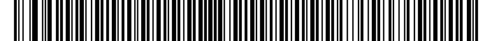
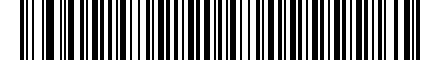
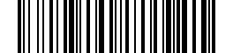

# Setting up a barcode scanner

A scanner sets itself up when it reads one of the codes below. Scan them from the screen or from a printout, one at a time, and hold the scanner close so it reads only the code you want. The scanner beeps when it takes one.

Most scanners need only the keyboard layout: the same as the computer or phone the station runs on. The [scan station](scan.md) says so when a code comes in with the wrong layout.

## Zebra DS2208

Back to the factory settings, when it does something unexpected:

Type as a keyboard, when it was set to another USB mode, e.g., IBM or OPOS:

Enter after each code, so the station prints at once:

### Keyboard layout

English (US), as it comes:

English (UK):

German:

French:

Italian:

Spanish:

Turkish (Q):

## NETUM C750

Back to the factory settings, when it does something unexpected:

Type as a keyboard, with the cable:

Type as a keyboard, with the USB receiver:

Read Aztec codes, which it skips as it comes:

### Keyboard layout

English (US), as it comes:

English (UK):

German:

French:

Italian:

Spanish:

Turkish (Q):

## Technical details

The codes hold the commands from the manuals of the scanners, drawn as Code 128 by [`tools/scanner_codes.py`](../tools/scanner_codes.py). Other scanners have codes like these in their manuals, usually under "keyboard language" or "country".
